# PS OPTICAL — Complete Premium Optical E-Commerce & Retail Platform


> **SEE CLEARLY. LOOK UNFORGETTABLE.**  
> An omnichannel luxury eyewear shopping experience, boutique retail locator, and multi-portal operations engine built with React, Vite, Node.js, Express, and MongoDB.

---

## 1. Brand Philosophy & Design System

PS OPTICAL discards generic technology aesthetics in favor of high-fashion optical editorial luxury:

- **Warm Ivory (`#F6F1E8`):** Editorial background canvas offering eye comfort.
- **Deep Espresso (`#30251F`):** Rich, tactile typography and dominant structural accents.
- **Terracotta (`#B65E43`):** Vibrant call-to-actions, primary purchase buttons, and urgency indicators.
- **Muted Olive (`#72785A`):** Secondary metadata, eco-acetate callouts, and badge backgrounds.
- **Champagne Gold (`#D4B483`):** Highlighting luxury titanium hardware and premium frame details.
- **Charcoal (`#272522`):** Executive dark-mode canvas for the Admin Operations Suite.
- **Pure White (`#FFFFFF`):** Product studio backgrounds and contrast surfaces.

---

## 2. Platform Architecture

The system features **three completely isolated user tiers**, each with independent routes, security enforcement, and custom UI design tokens:

```mermaid
flowchart TD
    Public[Public Experience] --> Home[Luxury Editorial Homepage]
    Public --> Catalog[Eyeglasses & Sunglasses Catalog]
    Public --> Detail[Product Detail & 6-Step Lens Wizard]
    Public --> TryOn[Virtual Try-On Studio]
    Public --> StoreLoc[Store Locator & Slot Booking]
    Public --> HomeTrial[Try-at-Home Booking]

    SubGraph1[Customer Portal /customer]
    Public --> CustAuth[Customer Login / Register / Verify]
    CustAuth --> SubGraph1
    SubGraph1 --> Orders[Orders & Live Tracking]
    SubGraph1 --> Rx[Digital Prescription Vault]
    SubGraph1 --> Appts[Booked Vision Appointments]
    SubGraph1 --> Returns[14-Day Returns & Exchanges]
    SubGraph1 --> Concierge[Support Concierge]

    SubGraph2[Staff Portal /worker]
    WorkerAuth[Worker Login & Recovery] --> SubGraph2
    SubGraph2 --> WorkerDash[Assigned Store Dashboard]
    SubGraph2 --> WorkerInv[Live Shelf Stock Management]
    SubGraph2 --> WorkerAppts[Patient Slot Operations]

    SubGraph3[Executive Portal /admin]
    AdminAuth[Admin Login & Recovery] --> SubGraph3
    SubGraph3 --> AdminDash[Revenue & Omnichannel KPIs]
    SubGraph3 --> CatalogCRUD[Frame & Category Management]
    SubGraph3 --> MultiStore[Physical Boutiques Directory]
    SubGraph3 --> StaffAdmin[Staff Account Provisioning]
    SubGraph3 --> GlobalInv[Multi-Store Inventory Balancing]
    SubGraph3 --> Audit[Immutable Security Audit Trails]
```



---

## 3. Key Feature Highlights

### 3.1 6-Step Lens Customization Wizard
Embedded directly into every frame's detail page:
1. **Lens Use:** Zero Power (Style/Blue-cut), Single Vision (Distance/Reading), Bifocal, or Progressive.
2. **Lens Type:** Clear Optical, Blue Light Filter, Photochromic (Sun-adaptive), Polarized, or Tinted Sunglasses.
3. **Index & Thinness:** Standard 1.50, Thin 1.56, Ultra-Thin 1.60, or Hyper-Thin 1.67.
4. **Premium Coatings:** Anti-Reflective, Scratch Resistant, Oleophobic Hydrophobic, UV400.
5. **Prescription Method:** Upload photo, enter manually, use saved digital vault, or request post-order consultation.
6. **Summary & Live Total Calculation:** Real-time transparent itemization.

### 3.2 Virtual Try-On Studio
- Live webcam streaming with real-time frame overlay and position/scale tuning.
- Photo upload mode for testing frames against uploaded portraits.
- Frame switcher and quick link to direct cart checkout.

### 3.3 Omnichannel Boutique Services
- **Flagship Store Locator:** Directory of physical stores with address, phone, opening hours, and geographic coordinates.
- **In-Store Eye Test Bookings:** 20-step zero-error eye test slot booking with live date-based availability checking.
- **Try-at-Home Service:** Select up to 5 designer frames delivered to your doorstep with an accompanying certified optician.

---

## 4. Technology Stack

### Frontend (`client/`)
- **React 19** + **TypeScript** + **Vite**
- **Tailwind CSS** + Custom Design Tokens
- **Framer Motion** (Fluid micro-interactions and staggered hero reveals)
- **Lucide React**
- **Axios** with automatic token interceptors and redirection

### Backend (`server/`)
- **Node.js** + **Express.js** + **TypeScript**
- **MongoDB** + **Mongoose ODM** (18 structured models with compound indexes)
- **Bcrypt.js** (12 salt rounds) + **JSON Web Tokens (JWT)**
- **Helmet**, **CORS**, and **Express Rate Limiters**
- **Nodemailer** HTML email templates with simulated fallback for local development

---

## 5. Quick Start Guide

### Prerequisites
- Node.js (v18 or higher)
- MongoDB instance (local or MongoDB Atlas connection URI)

### Step 1: Install Dependencies
```bash
# In the server directory
cd server
npm install

# In the client directory
cd ../client
npm install
```

### Step 2: Configure Environment Variables
Copy `.env.example` in `server/` to `server/.env`:
```env
PORT=5000
MONGODB_URI=mongodb://localhost:27017/ps-optical
JWT_SECRET=super-secret-key-ps-optical-change-in-production
CLIENT_URL=http://localhost:5173
```

### Step 3: Seed Initial Data
Populate demo categories, luxury frames, physical flagship stores, test coupons, and demo accounts:
```bash
cd server
npm run seed
```

### Step 4: Run Development Servers
```bash
# Terminal 1 - Start Backend API (Port 5000)
cd server
npm run dev

# Terminal 2 - Start Frontend App (Port 5173)
cd client
npm run dev
```

Visit `http://localhost:5173` to explore PS OPTICAL!

---

## 6. Pre-Configured Demo Credentials

The seed script creates ready-to-test accounts across all three portals:

| Portal | Email | Password | Role | Description |
|---|---|---|---|---|
| **Admin** | `admin@psoptical.com` | `Admin@123` | `admin` | Full control center, catalog CRUD, audit logs |
| **Worker** | `worker@psoptical.com` | `Worker@123` | `worker` | Store optician, inventory adjustments, appointments |
| **Customer**| `customer@psoptical.com` | `Customer@123` | `customer` | Shopping, custom prescriptions, orders, returns |

**Pre-configured Promo Coupons:**
- `WELCOME15` — 15% discount on orders over ₹1,999 (Max discount ₹1,000)
- `PSO500` — ₹500 flat discount on orders over ₹3,000

---

## 7. Build Verification

Both frontend and backend are completely type-safe and production-ready:
```bash
# Verify backend compilation
cd server && npm run build

# Verify frontend bundle
cd client && npm run build
```

---

## 8. License
Proprietary design and architecture created for **PS OPTICAL**. All rights reserved.
